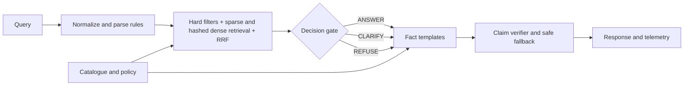

# TrustCart grounded shopping assistant

This repository snapshot did not contain the promised catalogue, policy, hidden questions, or cached model files when inspected (2026-10-18). The code therefore supports external CSV/JSON/JSONL/Parquet catalogue inputs and a policy text file, but the checked-in `data/catalogue.csv` and `data/policy.txt` are explicitly illustrative demo fixtures, not the claimed 5,000-product source. No model is downloaded or needed: deterministic local rules, BM25-style retrieval, and hashed-token dense vectors provide the offline fallback. The optional LLM hook is intentionally disabled.

## Run

From this directory: `python app/cli.py [--debug]`, `python app/web.py`, `python evaluate.py --questions data/dev_set.jsonl`, `python -m unittest discover -s tests`.

To use real data, set `TRUSTCART_CATALOG` and `TRUSTCART_POLICY` to local paths before launching. Inputs are discovered by filename if unset. Parquet requires pandas/pyarrow; JSON, JSONL, and CSV use the standard library. Set `HF_HUB_OFFLINE=1` and `TRANSFORMERS_OFFLINE=1`; neither is needed by the default runtime. Index caches are keyed by source content hash.

## Design

Facts are injected from catalogue/policy records. Query numbers are parsed as constraints and never become response facts. The verifier checks cited IDs, prices, stock, and citations sentence by sentence. Relaxations are disclosed. Ties between plausible product matches trigger clarification. Session filters persist and can be reset. The small local corpus uses deterministic token hashing for dense-like retrieval when no embedding runtime is available; install `sentence-transformers` with locally cached model weights only if adapting the optional embedding adapter.

## Data and limitations

See `DATA_NOTES.md`. The demo fixture is small and synthetic. Metrics generated from it are plumbing checks only and must not be interpreted as performance on the absent official dataset. Replace it with the actual catalogue/policy and regenerate the dev set before tuning thresholds. Runtime has no network access. Gradio is optional; the built-in web UI uses Python's standard-library HTTP server.

## Results

The generated synthetic fixture set contains 200 questions with a seeded 100/100 dev/held-out split. The current run measured 100% action accuracy for answerable, ambiguous, out-of-catalogue, and trap types on both splits; 100% claim support; 0 hallucinated prices; 100% expected-ID recall; and 0 verifier rescues. These questions are derived from a 10-row synthetic demo catalogue, so the perfect figures reflect a small controlled plumbing set and do not estimate performance on the absent official 5,000-item data.

On this machine, p50/p95 total latency was 0.37/0.61 ms on the 200-query fixture run, with 0 LLM calls and 100% LLM skipped. `python -m unittest discover -s tests` passed 12 tests. `pytest` itself was unavailable in the inspected offline Python environment; the tests are `unittest` tests and can also be collected by pytest after installation.

| Metric | Dev (200) | Held-out (100) |
|---|---:|---:|
| Behavior accuracy | 100% | 100% |
| Claim groundedness | 100% | 100% |
| Hallucinated price count | 0 | 0 |
| Expected ID recall | 100% | 100% |
